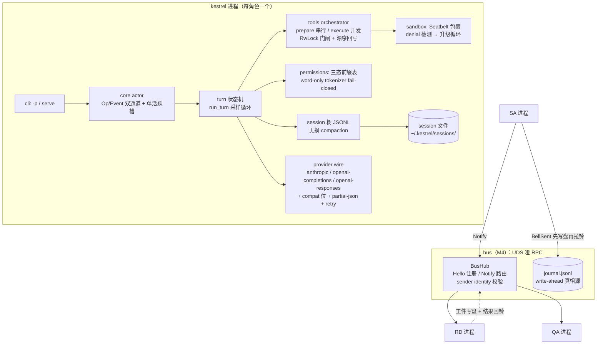

# kestrel 设计文档：Rust harness kernel

> 状态：M0-M4 已实现并通过测试；§10 二期已落地十三项 + 2026-11-04 走完的四格（§9.32–§9.35）——`ApproveMode::Bus`、
> 「判定 = 工件 + 证据文件」、bus 重连重放（停车补投 + 客户端重连）、journal 快照/截断语义、
> 多任务并行（task 命名空间 + 前缀寻址）、openai-responses wire（**真端点未实测**，§9.24）、
> journal 投影增量化与轮转触发（§9.25）、worker 池（一 task 一引擎一树，§9.26）、
> 预算价格表（usd 按 token 结算，§9.27）、journal 轮转的默认策略（活文件有界，§9.28）、
> 证据的类型化（按类型核对 + stage 要求齐全，§9.29）、审批批复的可靠投递（at-least-once + 幂等，§9.30）、批复回执与过期审批不谎报生效（§9.31）。
> 2026-11-04：role 路径的只读岛缺陷与「跑不起来的 runner」（§9.32）、验证 FAIL 回跳写者 + bash `output_path`
> 交出可核对的 test_log（§9.33）、证据自己携带结论（§9.34）、结论进入投影并被读走（§9.35）。
> 质量闸门保持人工执行（本仓库不挂 CI，见 §9.19⑥）。
> 二期十一项已于 2026-11-04 在真端点联跑中走完（`pipeline complete`，四阶段全 pass，
> 审批请求/判定/回执各 5 条成对）；那一次联跑抓出并修掉两个「测试全绿但跑不起来」的缺陷，见 §9.32。
> **Metrics** — src 51 files / 16485 lines · tests 9 files / 3319 lines · 238 tests (lib 186 + bin 4 + integration 48)
> **Integration** — core_loop 5 / discipline 2 / m1_tools 9 / m2_session 6 / m4_bus 15 / m5_pool 5 / sandbox_e2e 4 / wire_anthropic 2
> 规模已过 plan 预算（10-13k）的上沿：多出来的部分几乎都花在「取消安全」与「对账」这两条纪律上。
> 上面两行数字由 `tests/discipline.rs::metrics_lines_match_the_tree` 对照源码树重算校验——
> 这些计数此前在三处文档里手抄过三次、漂移过三次（§9.19），现在它是闸门不是仪式。
> 输入：实现规划（plan.md）与调研语料（codex / pi study notes、三方资料库 references.md）——均为开发过程资料，未随本仓库发布。
> 本文沉淀实现后的最终设计；与 plan 的偏差在 §9 逐条记录。

## 1 定位与非目标

**定位**：为星型多 Agent harness（SA 协调者 + RD 写者 + QA 验证者，多进程各接异构 LLM 后端）提供的 Rust 引擎内核。无头/极简 CLI：`-p` 单发（默认模式）、`serve` 常驻 worker、`demo-sa` 脚本化 SA、`hub` 总线进程；worker 的后端/总线地址来自 role 文件（`[llm]`、`bus_socket`），CLI flag 可覆盖。

**非目标**（二期清单见 §10）：TUI、MCP、插件/扩展系统、OAuth 订阅登录、Linux 沙箱、openai-responses wire、tree-sitter-bash 命令解析、execpolicy DSL。

## 2 总体架构

核心循环为 codex 形 actor（Op/Event 双通道、单活跃槽、token 树取消）；会话与压缩为 pi 形（append-only 树 + first_kept 无损检查点）；权限接口为 pi 形（`tool_call` 前置策略）、执行兜底为 codex 形（Seatbelt 默认包裹 + denial 升级）。

## 3 三方血统映射

| 组件 | 血统 | 蓝本锚点 |
|---|---|---|
| Op/Event actor、取消三件套、length 整批 fail | Codex | study-core-loop §1-2/§5 |
| `prepare_next_turn` 轮间快照（压缩+换模型）、steering 队列 | pi | study-pi-agent §1 |
| Tool trait prepare/execute 拆分、`tool_call` block 钩子 | pi | study-pi-infra §2 |
| RwLock 并行门闸、FuturesOrdered 源序 | Codex | study-core-loop §3 |
| Seatbelt 模板 + rename 逃逸防护 + denial 升级 | Codex | study-permissions §3/§5 |
| 三态前缀表 + 危险前缀禁令 | Codex（execpolicy 简化版） | study-permissions §2 |
| session 树 + firstKeptEntryId 无损压缩 | pi | study-pi-agent §4 |
| provider 双轴注册表 + compat 位 + key 三态 | pi | study-pi-ai §1-3 |
| provider 项目层禁入、无隐式 env 继承 | Codex | study-provider-context §3 |
| 帧协议（长度前缀 + strict 信封 + opaque 载荷）+ 路由三元组 | pi protocol | study-pi-infra §4 |
| journal write-ahead、状态靠重放定义 | Codex rollout + harness v3 §5 | codex-study-notes §6.3 |

## 4 关键类型与五条不变式

关键签名见 plan §2（`WireFormat`/`Op`/`EventMsg`/`Tool`/`PermissionEngine`/`Sandbox`/`Entry`/`Envelope`/`JournalRecord`），实现位于 `src/provider/wire.rs`、`src/core/{ops,events,actor,turn}.rs`、`src/tools/{mod,orchestrator}.rs`、`src/permissions/mod.rs`、`src/sandbox/{mod,seatbelt}.rs`、`src/session/{entries,store}.rs`、`src/bus/{frame,rpc,identity}.rs`、`src/journal/{records,mod}.rs`。

实现强制的不变式（都有测试背书）：

1. **取消三件套**：每个 await 过 `or_cancel`；`tokio::spawn` 必须包 `AbortOnDropHandle`（`tests/discipline.rs` 静态闸门，fire-and-forget/managed 两类豁免标记）；`ResponseStream` drop 通知上游。由它延伸出第四条纪律：**被 `tokio::select!` 取消的 future 不许留下坏状态**——落败分支会在半路被 drop，任何「取出共享资源、用完再放回」的写法都必须用 RAII 归还（`bus::rpc::Taken`），否则那条连接会被永久破坏；而「一帧都不能丢」的读取要放进取消不了的专职 reader 任务（`cli::pool` 的泵）。
2. **fail-closed**：tokenizer 解析不了 → Ask；未设角色/无策略 → Ask 或 Deny；QA 写范围为零；审批者沉默、回复不可解析、或 SA 没有授权表 → Deny（`approve_timeout_secs`，默认 120s）。
3. **只追加**：session 永不截断；journal 的**活文件**可以变短，但只允许在旧前缀已被折成 `snapshot` 检查点并归档成段之后——历史不消失，只是搬出活文件（§9.22）。回滚/恢复 = 重放；半写容忍（残行 skip）。
4. **sender identity**：Hello 声明 + 帧内 sender 强一致；伪装者断连；bus 来源 item 渲染带 `<bell from>` 标注。
5. **journal 是真相**：StageWritten → BellSent → notify 的调用序强制 write-ahead；state 投影从 journal 重生成。投影可以**增量维护**（`Folder` 每追加一条走一步，避免每次派发都重放整个文件），但增量与全量必须是同一次折叠——`projection_equals_a_full_replay_after_every_append` 断言两者逐次相等，否则「预算停损读的是缓存、巡检读的是重放」会分成两份真相。

## 5 安全模型

双层：策略层（JSON 三态前缀表，policy = 数据，决策 Allow/Ask/Deny；`all_segments_explicitly_allowed` 才允许免沙箱）× OS 层（Seatbelt `(deny default)` + 参数化 writable_roots + 祖先 `file-write-unlink` 防 rename 逃逸 + 网络全禁仅留 loopback proxy）。沙箱失败经 exit 2/126/127/SIGSYS/stderr 特征判定 → ApprovalRequest → 批准后脱沙箱重试一次。**诚实边界**：v1 威胁模型是防手滑防漂移（同机同用户），命令解析是保守 word-only（`&&`/管道分段评估，其余结构一律判失败），不防恶意。

审批的第三种落点（`ApproveMode::Bus`，§10 二期首项）：Ask 不再只有「预先 all / 预先 none」两个答案，worker 可以把请求发给一个审批 peer。三个约束让它不会变成后门：

1. **请求带数据不带心情**：`approval_request` 帧携带 `tool` + `args` + 可判定的 `command`（`approval_detail` 把工具名与参数折进载荷），审批者判的是命令行本身，不是一段措辞。
2. **审批者的权力也是一张表**：SA 用 `roles/sa.approvals.json`（与 role policy 同格式的三态前缀表）判定，只有显式 Allow 放行；Ask/Deny/命令为空/没有表 → deny。协调者不能放宽角色策略里没写过的东西。
3. **沉默 = 拒绝**：`approve_timeout_secs`（默认 120s）到点由 worker 自己 deny，审批不会把回合挂死；总线断开时立刻 deny 全部在途请求，不在死 socket 上空转。**沉默**与**没送到**现在是两件事：请求按 at-least-once 重发（§9.30），窗口内仍无人应答才叫沉默。

`-p` 单发模式没有总线可问，声明 `approve = "bus"` 启动即报错（不静默降级成 none）。审批的两个动作都进 journal（`approval_requested` → `approval_decided`，先写盘再回铃），所以「谁把沙箱放宽了」在崩溃后仍可复现——不变式 5 对安全事件的延伸。

## 6 配置与多后端

| 层 | 来源 | 可定 provider/key |
|---|---|---|
| runtime | CLI flag | 是 |
| role | `harness/roles/<role>.toml` | 引用 + 权限/沙箱 |
| project | `.kestrel/kestrel.toml` | **否（启动即报错）** |
| user | `~/.kestrel/providers.toml` | 唯一归属地（key 三态：字面量 / `$ENV` / `!cmd`） |
| env | 仅被显式 `$VAR` 引用 | 无隐式 ANTHROPIC_* 回退 |

每角色一个 TOML = 「一角色一后端」：SA→qwen3.8-max、RD→deepseek-v4-flash、QA→glm-5.3-flash（示例见 `harness/roles/`）。对照 CC 方案（harness-v3 §6.2 的 settings 优先级对抗 + 钉全集仪式）此处 provider 归属在类型层唯一，无需仪式。

工具审批走同一条优先级链：`--approve all|none|bus`（runtime）> role 的 `[permissions].approve` > `none`（拒绝，fail-closed）。此前 `serve` 硬编码 HeadlessDeny，worker 永远走不到「沙箱拒绝 → 审批 → 脱沙箱重试」这条回路；现在 role 可以声明三态（demo 里 RD = `bus` 且 `approver = "harness-sa"`，QA 保持缺省拒绝）。runtime 只覆盖**模式**，不覆盖 role 声明的 `approve_timeout_secs`（`with_role_deadline`）——一个 CLI flag 不该顺手把审批等待改成无限。

role 文件的路径字段（`write_roots`/`read_only_islands`/`policy_file`/`prompt_file`）支持 `$VAR`、`$VAR:-fallback`，以及要再接路径的 `${VAR:-fallback}/子路径`：role 是共享文件，把某台机器的绝对路径钉进 `write_roots` 等于把沙箱写范围钉死在那台机器上（demo 的 worktree 由 `run-demo.sh` 导出 `KESTREL_WORKTREE`，于是 SA 广播的 `ref` 与 RD 能写的目录同源）。变量未设且无 fallback 是**带拼写的硬错误**——静默丢掉一个写根会悄悄改变沙箱边界。裸写 `$VAR:-fallback` 时 `:-` **拥有整条后缀**，所以「默认值之后再拼路径」只能用花括号形式；写成 `$WT:-/tmp/wt/.git` 会在 env 设过时悄悄丢掉 `.git`，§9.32① 的只读岛事故就是这么来的。

预算不写进 role：`[budget].max_usd` 曾在三份 role 里各有一份，而代码中没有任何读者——花钱的上限由 SA 的 journal 账本执行（`demo-sa --max-usd`），单点权威，与「provider 归属唯一」是同一条理由。

钱怎么算：费率跟着 provider 住在用户层（`providers.toml` 里每个 model 的 `cost`，单位是每百万 token 美元），role 文件只声明「本角色跑在哪个 provider/model 上」。SA 把这两张表拼起来（`--roles-dir` + `--prices`）就能把 worker 报回的 token 读数换成账单；**查不到价时记名义值**（`--nominal-usd`，缺省 0.5）并把它单独计入 `nominal_usd` 报出来，绝不按 0 计——按 0 记账的停损等于没有停损（详见 §9.27）。

会话归属：`-p` 一次调用一个 append-only 树，默认新建，`--resume last|<id>|<path>` 续接。`serve` 的归属单位是 **task**：一个进程为每个 task 各起一台常驻引擎、各开一棵树（`--max-tasks`，缺省 4；超限的门铃被显式拒绝），每颗门铃是那台引擎上的下一个回合，因此历史、read-before-edit 台账与压缩检查点跨派发存活，但**不跨 task 串台**（`AgentHandle::spawn` 从树上重建 history/history_ids，并把 ctx_tokens 预置为重建上下文的估算值，否则恢复出的大会话要先采样一次才可能触发压缩）。

## 7 里程碑与验收（已全部达成）

| M | 内容 | 测试 |
|---|---|---|
| M0 | actor 循环 + SSE 归一化 + 取消 + steering + 最小 anthropic wire（2.4k 行） | 20 项：fixture 续轮/length 整批 fail/中断 100ms/steering 注入/spawn 闸门 |
| M1 | 4 工具 + 权限引擎 + Seatbelt + 三态表（1.8k 行） | 24 项：并发墙钟/沙箱 e2e×3（真实 sandbox-exec）/rename 逃逸/三态矩阵/edit golden/sbpl golden/错误回灌 |
| M2 | session 树 + 无损压缩（0.8k 行） | 15 项：golden JSONL/半写/fork/压缩触发+merge/开关模型落盘/resume |
| M3 | 诚实 wire 层：双 wire + compat + partial-json + thinking 回放 + retry + registry（1.5k 行） | 23 项：registry/金身回显/双 wire 归一/前缀穷举/重试矩阵/compat flip |
| M4 | 哑 RPC 总线 + journal + 三角色 demo（1.5k 行） | 13 项：帧 strict/路由/identity/注入面/崩溃对账/预算 |

**遗留人工项**：三端点 LLM 实测已全部完成（DeepSeek/BigModel 见 `smoke-report.md` §2.1-2.2，Qwen 见 §2.3；compat 偏差逐条落 compat 位，plan §7.1），其中 Qwen 暴露的 wire 层缺陷与修复见 §9.9。三角色联跑已跑通（`harness/run-demo.sh`，见 §9.11）。demo 任务下 RD/QA 曾在轮预算内收敛不到文字答复（工件 `stop` 显示 `round budget exhausted`）——那是任务/提示词层面的现象而非通路缺陷；自 §9.13 起 SA 只按工件内容判定（空结果=fail+回派），角色 prompt 也写了硬性收敛纪律，「pipeline complete」不再可能由空答案支撑。

## 8 测试策略

faux provider 第一天进 trait（`WireFormat` 抽象 ByteStream + `render_request` 纯函数）→ 零真 key 覆盖全部验收；三层测试（单元/组件 golden/e2e）；determinism 经 `IdGen`/`Clock` 注入；沙箱 e2e 仅 macOS（`#[cfg(target_os="macos")]`）；闸门 = `cargo fmt --check` + `clippy -D warnings` + 全测试，**人工执行、每次改动都跑**：本仓库不挂 CI（2026-10-28 试过 `ci.yml`，同日按决定移除，见 §9.19⑥），所以这道闸门没有兜底机制——rust/clippy 1.98 那次破功就是因为只靠人记得跑。

数量与分组见文首的 **Metrics** / **Integration** 两行——它们由 `tests/discipline.rs` 从源码树重算并对照，不是人抄的。此前 README / design / 报告三处各写一个数（137 / 137 / 121，实跑 130），漂移记在 §9.19；现在改完代码忘了同步文档，转闸门就会红，且失败信息直接给出正确的那一行。总线测试需要真 UDS `bind`，在严格沙箱或容器里以 `EPERM` 失败，属环境限制而非回归。

## 9 与 plan 的偏差（诚实台账）

1. `Op::SwitchModel` v1 携带具体 spec（plan 为 provider id）——registry 落地后改为 id 解析已排入 M4 收尾，当前由调用侧解析。
2. `ensure_done` 适配器放 wire 层而非循环层（流尾恒一个 Done 的保证对双 wire 复用）。
3. compat 位收敛为 3 个有实际行为的 flag（`max_tokens_field`/`tolerate_unknown_finish`/`stream_include_usage`），plan 草案的 reasoning/thinking 格式位在 openai-chat wire 上以「不回发」策略落地（"Armin is wrong" 原则），未引入未用 flag。
4. partial_json 实现约 90 行核心（plan 估 250）：repair + 逐字符 pop 收敛足够覆盖测试矩阵。
5. demo-sa 是脚本化状态机（无 LLM 派发智能）——验证机械语义；智能派发为二期。
6. 里程碑行数落在预算下沿：引擎薄于预估（pi 佐证的 2k 结论），wire 层 1.5k 而非 4-5k——因为 v1 只钉两个 wire 且 compat 只实现有行为的位；三期端点实测可能上修。
7. **BigModel（glm-5.3-flash）实测三项偏差（2026-09-10 smoke）**：① CC 风格的 `[1m]` 模型后缀网关不认（报 1211 模型不存在），kestrel 用裸 id——该后缀是 CC 侧的上下文标记，若需 1M 上下文应映射为 beta header 而非模型名（二期 compat 位）；② 认证双头通吃：x-api-key 与 `Authorization: Bearer` 同时发送即通过（已实装，pi anthropic.ts 同法）；③ `message_start` 不回 input usage（`input_tokens=0`），usage 低报会推迟压缩触发——**已修**：ctx_tokens 记账改为「reported input 为 0 时用 TurnContext 字符估算兜底」（turn.rs + 回归测试 compaction_triggers_on_estimated_context）。
8. **DeepSeek（deepseek-v4-flash-vision-exp）实测（2026-09-10 smoke，双场景通过）**：对话流式与 bash 工具回合全通；usage 上报**完整**（input 565/output 21）——证实 input=0 低报为 BigModel 特有，§9.7③ 的估算兜底按端点自动分工正确；认证同走双头；cc-switch 配置中的 `[1m]` 后缀未测（用裸 id 通过）。
9. **Qwen（百炼 Token Plan）实测（2026-09-17 smoke）暴露 wire 层缺陷并已修**：openai 表面的流式 usage 恒为 0。根因不是端点低报（该端点上报完整），而是 `parse_stream` 一见 `finish_reason` 就终止，而百炼把 usage 放在其**之后**的 `choices: []` chunk——消费循环在 `Done` 处 break，尾部 usage 永远读不到。修法：终止推迟到 `[DONE]`/流尾，`finish_reason` 只记入 `pending_stop`；顺带把「有 `[DONE]` 无 `finish_reason`」判为 `Stop`（原判 `Aborted`，会让 turn 循环丢弃模型输出）。**影响面**：所有 usage 后置的 OpenAI 兼容网关——此前从未被真实端点跑过（DeepSeek/BigModel 走的是 anthropic wire）。回归测试 4 项；同轮修掉 thinking-only 回合的空 `message_done`。详见 `smoke-report.md` §6。
10. **Qwen 端点形态（2026-09-17 smoke）**：百炼 Token Plan 主机同时提供 anthropic 兼容（`/apps/anthropic`，供 SA 角色）与 openai 兼容（`/compatible-mode`，供 Codex）两个表面，两侧凭据实测**互通**；`/anthropic`、`/v1/messages`、`/compatible-mode/v1/messages` 均 404。openai 表面须置 compat 位 `stream_include_usage = true`，否则全程 `"usage": null`。provider 定义见 `~/.kestrel/providers.toml`（qwen-anthropic / bailian-qwen / deepseek-anthropic / zhipu-anthropic 四条，key 均以 `!cmd` 引用 cc-switch DB，不落明文）。
11. **三角色 demo 首次跑通（2026-09-17）**：`harness/run-demo.sh` 此前从未跑通，补齐四处：① 总线 hub 进程缺失——`BusHub::bind` 只在测试里被调用，新增 `hub` 子命令（脚本先起 hub 再起 worker，轮询 socket 就绪）；② CLI 形状不符——`serve`/`demo-sa` 改为子命令，`-p`/`--model` 改为可选（`-p` 单发保持向后兼容），`--rd-role`/`--rd-model` 这两个 demo 用不到的参数删除；③ role 的 `[llm]`/`bus_socket` 是死配置——`RoleConfig` 现在解析二者，worker 的后端与总线地址由角色声明（design §6 的"一角色一后端"首次真正落地）；④ 工件命名不一致——serve 写 `{session}-{route.session}-iter{n}.json`，SA 找的是 `{target}-{stage}-iter{n}.json`，"读盘为准"巡检永不命中，改为 `{session}-{stage}-iter{n}.json`。
    调试中另暴露两个真 bug：**role 相对路径基准错**（`harness/roles/rd.toml` 写 `prompt_file = "systems/rd.md"`，代码按 role 文件所在目录解析，实际文件在兄弟目录 `systems/`；`-p` 侧把这个错误静默吞掉回退成空 system prompt，所以只有 worker 起不来）与 **工具批次历史按调用交替提交**（见 §9.12）。工件新增 `stop` 字段，空结果从此可自解释。
12. **并行工具批次必须成组提交（2026-09-17）**：`outcomes_to_history` 原按「每个调用一对 assistant/user」交替写历史，导致第二个 `tool_use` 落在没有 thinking 块的 assistant 消息里。DeepSeek 在 thinking 模式下直接 400（`The content[].thinking in the thinking mode must be passed back to the API`），而同样的历史一次只有一个工具调用时不会触发——所以三端点 smoke 全绿也没暴露它。最小复现：交替形状 400 / Anthropic 惯用的「一个 assistant 装全部 tool_use、一个 user 装全部 tool_result」200。修法：改为 `outcomes_to_history` 批量提交（全部 tool_use 在前、全部 tool_result 在后），openai wire 相应把同批 `tool_calls` 合并进一条 assistant 消息。

13. **一期标称但没接线的四处（2026-10-26 冒烟复盘，已修）**：
    ① `serve` 在每颗门铃里 `AgentHandle::spawn` 且传 `session: None`——worker 跨铃无历史、`~/.kestrel/sessions` 里连一个 worker 会话文件都没有，「常驻」名不副实。改为一个 worker 一个常驻引擎 + 一棵会话树（回归测试 `resumed_store_carries_history_into_the_next_turn`）。
    ② 会话树与无损压缩在 CLI 上**不可达**：`SessionStore::open/prompt_items` 只被测试调用，`-p` 没有续接口，而 `should_compact` 只在回合起点检查（`-p` 恰好只有一个回合）。新增 `--resume last|<id>|<path>`（配套 `SessionStore::list/resolve`），spawn 时从树上重建 history/history_ids 与 read-before-edit 台账，并把 `ctx_tokens` 预置为重建上下文的估算值——否则恢复出的大会话要先生成一轮才可能触发压缩（回归 `resume_compacts_before_the_first_sample`）。
    ③ `--tools` 是 `default_value_t = true` 的 bool flag：只能开不能关，`--tools false` 报「unrecognized subcommand」，而 README/help 把它写成 opt-in。改为默认关 + `--tools[=BOOL]`（`num_args = 0..=1` + `default_missing_value`）。
    ④ `serve` 硬编码 `ApproveMode::HeadlessDeny`，worker 走不到「沙箱拒绝 → 审批 → 脱沙箱重试」这条回路。新增 role 键 `[permissions].approve`（非法值一律回落为拒绝）+ `--approve` 覆盖，优先级 runtime > role > 拒绝。
14. **demo 的 pass 是假的（2026-10-26 冒烟复盘，已修）**：`sa_demo` 判 stage 收敛只看工件是否存在，不读 `result`/`stop`，于是 RD 那份 `result:""` + `stop:"round budget exhausted"` 的工件也能让四个 stage 全绿并打出「pipeline complete」。现在判定只读盘（`verdict_from_artifact`：空结果、aborted、`stop.type == "error"` 均为 fail），fail 走真实回派环——iter 自增、journal 落 `pass:false` 的 `result_committed`。demo 预算 2.0 只够 4 次派发（一次回派即触顶），默认上调为 4.0 并开放 `--max-usd`。两个角色 prompt 同时补了硬性收敛纪律（最后一次回合必须留给人工可读的文字结论；同类工具失败最多再试一次），否则「修好判定」只会把联跑变成常红。
15. **闸门与诊断（2026-10-26 冒烟复盘，已修）**：rust/clippy 1.98 新增 `clippy::question_mark` 让 `cargo clippy --all-targets -- -D warnings` 破功（tokenizer 的悬空转义分支）；配置类错误只吐 `No such file or directory (os error 2)` 而不说是哪个文件——role config 读/解析、policy 表、system prompt、provider registry 四处全部带上路径。design/README 的规模数字按实测修正。
16. **「读盘为准」缺了指针本身（2026-10-26 修判定后暴露）**：`serve` 只把铃 payload 的 `task` 塞进 prompt，`check` 与 `ref`（artifacts/worktree 路径）被丢掉，worker 拿不到验证对象——QA 连续三轮只能回「证据不足（缺 ref.worktree）」。修法：`bell_prompt()` 把 task/check/iteration/ref 一并交给 worker（铃仍是薄消息，但指针必须可读），demo-sa 的 `ref` 补 `--worktree` 广播 RD 的写入目录。修完判定才真正有意义：worker 自述 `PASS`/`DONE` 为收敛，`FAIL`/`BLOCKED`/无判定词为 fail 并回派（`verdict_marker_decides_the_stage`）。
17. **联跑的计时与预算假设过期（2026-10-26）**：SA 原先硬编码 180s 等回铃、2.0 USD 预算，二者都是「一次派发 = 一次冷引擎」时代的数字。常驻引擎 + 8 轮工具回合 + 真网关（BigModel 单轮实测 48-77s）下 180s 必然误判为「铃丢了」；一次诚实回派也会直接触顶。改为 `--bell-timeout-secs`（默认 300）与 `--max-usd`（默认 6.0 = 4 stage × 3 iter × 0.5，让预算覆盖声明的重试策略），run-demo.sh 可用 `KESTREL_DEMO_BELL_TIMEOUT` / `KESTREL_DEMO_MAX_USD` 覆盖。
18. **判定变严之后，demo 自身的矛盾才暴露（2026-10-26）**：① 角色 prompt 要求 RD/QA「把结果写进 artifacts」，可 RD 的写范围只有 worktree、QA 写范围为零——它们每轮都在撞自己角色的墙；结论改为「文字回答，由 `serve` 落成工件」。② QA 没有目录发现手段（策略只放 `ls`/`rg`/`cat`/`cargo`/`python3 -m`），又没有 RD 产出清单，只能猜文件名，三轮都只能回「证据不足」；因此 RD 的 `DONE` 必须逐条列出新建/修改的绝对路径与测试入口，QA 按清单取证（读 RD 工件 → 按路径读源码 → 单条已允许的命令执行），并且 `python3 -m` 进入两侧允许表（此前 QA 的允许表里没有测试运行器，`test` stage 在结构上不可能拿到执行证据）。③ 命令拼接纪律：`&&`/管道分段求值，任一段不在允许表里整条被拒——prompt 里写明用单条命令，避免把策略失败读成实现失败。这三条都不是内核缺陷，但只有先把 SA 判定做实，它们才会被看见（此前「工件存在即 pass」把它们全盖住了）。

19. **文档与配置的漂移（2026-10-28 修正）**：① 测试数三处不一致——README/design 写 137、报告写 121、实跑 130；② README 的规模拆解（wire ~1.5k、总线+journal ~1.5k）与实测（provider 2.58k、bus+journal 1.08k）不符；③ journal 的 `budget_spent` 记 `usage: 0` 却写 `usd: 0.5`，读起来像按 token 计费，实际是 `per_dispatch_usd` 的固定名义扣费——口径改为「fixture 名义停损」，真实 token 由结果铃带回并另记 `usage_reported`；④ 三份 role 的 `[budget].max_usd` 没有任何读者，删除；⑤ RD 的 `write_roots` 硬编码 `/tmp/kestrel-worktree`，改为 `$KESTREL_WORKTREE:-…`；⑥ 闸门只靠人记得跑（1.98 那次 clippy 破功，§9.15）——同日补过 `.github/workflows/ci.yml`（ubuntu + macOS），随后按决定移除：**这个仓库不挂 CI**，闸门回到「每次改动人工跑 fmt/clippy -D/test，跑不过不算完成」，代价是这类失真只能靠人兜。数字与配置写错的代价不是难看，而是让人不再核对它们。

20. **二期开工：审批反向请求 + 证据层（2026-10-28）**：`ApproveMode::Bus` 落地（§5）。三个关键取舍：请求载荷必须带 `tool` + `args`（`approval_detail`），否则审批者只能对措辞表态；审批者自己的权力也来自一张三态前缀表（`roles/sa.approvals.json`，只有显式 Allow 放行）；`Waited::TimedOut` 与总线断开都由 worker 侧 deny——一期的 `Bus` 分支是无期限等待，一个不答的 SA 能把 worker 的回合永久挂住，这本身就是可用性缺陷。SA 判定加第三层「证据核对」（`cli/evidence.rs`）：`serve` 从结论取绝对路径（优先机器可读的 `evidence:` 行）写进工件，`verdict_from_artifact` **只在 worker 声称收敛时**核对这些路径存在且非空，FAIL 不额外举证——证据层是为了防止「把 verify 说成通过」，不是给拒绝增加文书工作。同时 `serve` 在回合结束清空在途请求，迟到的批复不会被下一个回合误读。尚未做：按文件类型核对证据（截图/测试产物）、`-p` 模式的本地审批通道。审批请求与批复都是 Notify，跨断线投递由 §9.21 负责，但迟到的批复仍被 worker 丢弃——语义停在超时 deny，不会变成静默放行。

21. **bus 重连重放（2026-10-28，部分落地）**：总线原先「断线即静默丢帧」，`serve` 还会因 `recv_notify` 报错而退出——hub 重启 = 整个拓扑报废。现在三件事分开处理：
    ① hub 断线只清连接表，**保留 session 归属**，于是「注册过但不在线」与「从未注册」可区分：前者的 Notify 进停车队列（每 session 32 帧、全局 256 帧，drop-oldest 并 warn），重新 Hello 时按序补投；后者仍立刻回 `unknown session` Error——把拼错的 session 名静默停车等于让铃永远没人听见。
    ② 客户端 `recv_notify` 自动重连（100ms 起指数退避，单窗口 10s），`Drop` 显式 abort 两个 pump 任务，让 hub 立即看到 EOF 并开始停车；worker 不再因 hub 重启而退出。
    ③ **RPC 不跨重连**：Response 的路由属于那条死连接，所以 `request` 在无连接时 fail fast，Request 帧也不进重放队列。同理，已经写进「随后死掉的 socket」的帧不重放——hub 可能已经处理过它，重复铃由 SA 侧 write-ahead 对账消化（§5 不变式 5），而不是靠总线猜「大概没送到」。审批批复因此可能因重连而迟到并被 worker 丢弃（`open` 已在回合结束时清空）——语义仍是超时 deny，不会变成静默放行。
    未做：跨 hub 进程重启的停车表恢复（停车只在一个 hub 生命周期内有效）、按 peer 的可靠投递确认。`run-demo.sh` 里等注册的那一拍仍然需要。

22. **journal 快照/截断语义（2026-10-28）**：不变式 3 原话是「journal 永不截断」，实现上等于把一个只增不减的文件当成真相本体。现在拆开三件事：
    ① `JournalRecord::Snapshot { covers, checkpoint }`——检查点折的是「到此刻为止的投影」：stage / iteration / 每 peer 花费 / **未结算的铃清单**。最后这项是关键：截断若丢掉 in_flight，一次「worker 写完工件但死在拉铃前」就会被 SA 误读成「从没派发过」而重烧一轮预算，正是 journal 要防的事。
    ② `rotate(keep)` 把新于 `keep` 之外的前缀折成检查点并搬到归档段 `<stem>.seg<from>-<to>.jsonl`；段文件+活文件 = 完整历史（`replay_all()`），审计链不断。活文件的 `replay()` 里出现 Snapshot 时，折叠**从检查点重启**而不是继续累加，否则预算会被重复计一次。
    ③ 轮转顺序即安全性：全程持住 append 锁 → 段落盘 fsync → 新活文件写 `.new` 并 fsync → `rename` 原子替换 → 通过已持有的 guard 换 fd（先放锁再换会有「写进旧 inode」的窗口）。**段名取「覆盖的记录区间」而不是计数器**，`covers` 因此是累计值：这样「段已写好、rename 前崩溃」后重试会覆盖同一个文件，而不是把同一段前缀归档第二份——后者会让 `replay_all` 把预算重复计一遍。测试：`a_crashed_rotation_is_retried_idempotently`（手工造出崩溃残留）与 `concurrent_appends_survive_rotation`（4 线程并发追加 × 40 轮 rotate，断言 40 条记录不重不丢、无 `.new` 残留）。
    语义边界：**这不是删除**。段文件不自动清理，`session` 树仍完全不截断。当时 `demo-sa --rotate-after-records` 缺省 0（不轮转），理由是「阈值该由派发节奏定，不该由库猜」——这一条后来由 §9.28 收口：默认策略给的是**活文件的可读边界**，不是派发节奏。

23. **多任务并行（2026-10-28）**：一个 hub 上并存多条 pipeline，前提不是并发而是**命名空间不串台**。原先 `demo-sa` 把 task 写死成 `"demo"`，工件名 `{session}-{stage}-iter{n}.json`：两条 pipeline 打同一个 worker 名、同一个 stage 时，后一条会读到前一条的工件并把它判成 pass——这是 §9.11④「两端各拼一遍文件名」那类 bug 的升级版。现在四件事：
    ① `cli/task.rs` 是唯一一份命名契约：`artifact_name(session, task, stage, iteration)`——SA 找文件与 worker 写文件调同一个函数，`serve` 不再自己 `format!`。
    ② task id 三处同源：journal 每条记录、门铃 payload（`task_id`）、工件名与结果铃（worker 原样带回，SA 不会认错回执）。没带 `task_id` 的铃落进 `default` 命名空间，而不是从自由文本 `task` 里猜一个出来。
    ③ slug 把任意文本变成安全的文件名片段：非 `[A-Za-z0-9._-]` 一律变 `-`（中文任务名退化成 `demo-LRU-cache`），`/` 被消灭，`.` 与 `..` 换成带 FNV-1a 后缀的名字，超长截断也保留唯一性。**task id 来自另一个进程却要变成文件名，它不是可信任的输入**。
    ④ 寻址用前缀：`serve --session t2:harness-rd` 配 `demo-sa --task-id t2 --rd-peer t2:harness-rd --journal t2.jsonl`。session id 本来就是 opaque 字符串，hub 不改一行代码就能把两条 pipeline 路由隔开；`--rd-peer/--qa-peer` 让 SA 知道该打哪一对 worker。
    边界要说清：这一项解决的是「并存不串台」，不是「一个引擎同时服务两个 task」。单活跃槽（§4 不变式）依旧，同一 worker 收到两颗铃仍是一回合一回合地跑；真并发需要 worker 池，仍在 §10。

24. **openai-responses wire（2026-10-28，第三条 v1 wire）**：`api = "openai-responses"` → `POST /v1/responses`。它与 chat 的差三处，不是兼容位能糊过去的：系统提示走顶层 `instructions`；历史是 `input` 项列表（`message` / `function_call` / `function_call_output`），因此**并行工具批次天然成组**——§9.12 那条「一个 assistant 装全部 tool_use」的形状约束是 chat/anthropic 的事，这条 wire 上不存在；usage 搭在终止事件 `response.completed` 的 `response.usage` 里，所以 §9.9「finish_reason 之后还有 usage」的延后终止补丁在这里没有对应问题（终止事件本身就是唯一的 usage 载体）。
    映射规则要说清：`response.incomplete` + `incomplete_details.reason == "max_output_tokens"` → **`Length`，不软成 Stop**，否则 §4 的「length 整批 fail」纪律在这条 wire 上静默失效；`response.failed` / 顶层 `error` → `Error`（`server_error` / `rate_limit_error` 标 retryable，交给 retry 层）；流尾没有终止事件 → `Aborted`，且**不吐出已积累的 tool call**（回合会丢弃 partials）。
    取舍延续 §9.3：只发有行为依据的字段——`store: false`（会话树才是真相源，不让服务端另存一份）、`max_output_tokens`、扁平 tools + `tool_choice`；`reasoning.effort` 没实测就不发。思考内容仍是不透明 blob：blob 本身就是 Responses 的 `reasoning` 项（带 `encrypted_content`）时原样回显，anthropic 形状的 blob 直接跳过。
    **诚实边界**：这条 wire 只有金身请求体 + fixture 事件流验证（7 项），**没有跑过任何真端点**——本会话既无 OpenAI 凭据也无网络。它与 §9.7-9.10 那三条实测过的 wire 不同级：usage 字段命名、`call_id` 与 `item.id` 的实际填法、reasoning 项的回显要求，都可能像 Qwen 那轮（§9.9）一样暴露结构偏差。真端点实测已随 model-in-the-loop evals 排在 §10。

25. **journal 投影增量化 + 轮转触发（2026-10-28）**：不变式 5 说「state 投影从 journal 重生成」，实现里它是**每次派发都把活文件读一遍再折一次**——O(历史) 的开销挂在最热的路径上（预算停损 + 丢铃巡检都要它）。现在：
    ① 折叠逻辑抽成唯一的 `Folder`（`apply` 一条 / `report` 取投影），`reconcile(records)` 只是把它跑一遍。在线投影与全量重放因此**不可能各写一套**；`projection_equals_a_full_replay_after_every_append` 逐条断言两者相等（含轮转后重新播种）。
    ② `Journal` 持一份在线投影：`append` 顺带推进一步（锁序固定 file → projection，与 `rotate` 一致），`projection()` / `live_records()` / `file_bytes()` 都是 O(1)。SA 的预算停损与丢铃巡检改读投影。
    ③ 轮转触发 `rotation_due(records, bytes, cap_records, cap_bytes)`：两个上限任一超限即折，0 关闭该条件。字节上限是必要的——记录大小不齐（一条 `approval_requested` 带着 stderr），只按条数封顶挡不住文件长大。保留新近一半，于是活文件在上限的 1/2~1 之间浮动。**退化情形由库自己挡**：`rotate` 在前缀不足 2 条原始记录时返回 `None`——折一条记录进检查点会让活文件变长（检查点那行比它替换的记录更贵），这种守卫不能指望调用方给的阈值刚好。
    ④ 顺带修掉一个既有缺陷：`Journal::create` 开的是追加模式，却把投影当空的。配合 `KESTREL_DEMO_KEEP_JOURNAL=1`（跨运行续账本）时，**昨天花掉的钱与没结算的铃在重启后被忘掉**，停损形同虚设。现在 `create`/`open` 都从盘上播种（`create_seeds_the_projection_of_an_existing_journal`）。
    当时仍不做的事：库自己决定阈值（缺省 0 = 不截断）。后来收了口——阈值不该由「谁记得传 flag」决定，见 §9.28。

26. **worker 池：一 task 一引擎一树（2026-10-28）**：§9.23 解决了「并存不串台」，但同一 worker 收到多颗铃仍是一回合一回合地跑。这一项把它变成真并发，做法是**加一层归属，而不是放宽不变式**：单活跃槽（§4）是取消、steering、压缩时序的地基，动它等于把整套时序重推一遍；真正的并行单位是 task。
    ① `cli::pool`：pump 持有唯一的总线读写，按 `task_id` 路由到该 task 的 worker；每台引擎一个 `AgentHandle` + 一棵 `SessionStore` 树 + 一条自己的 8 轮预算。task 之间不共享历史，read-before-edit 台账与压缩检查点因此不会互相污染。
    ② 审批归属收在 pump 一处：worker 只递交 `ApprovalOpened` / `Notify` / `ApprovalClosed`，pump 学一次 `req → task`，批复**按 req 定向**投递、绝不广播——一次 `allow` 落到别的 task 就是权限绕过（§5）。回合结束 worker 关闭在途请求，路由表因此有界。
    ③ `--max-tasks`（缺省 4）超限时**显式拒绝**并发一颗 error 铃，而不是把活排进看不见的队列：静默排队在 SA 眼里就是「铃丢了」，会白烧它的重试预算。
    ④ 顺手抓住两个真缺陷，都在「取消」这条纪律上：
       - `BusClient::take_inbox` 是「取出接收器、用完放回」，而 `tokio::select!` 会 drop 落败分支——接收器从此不回来，那条连接之后每次读都以 `inbox already polled` 失败，泵静默变哑。上一版 `serve` 的审批循环是同一种形状，同样中招。修法是把归还做成 RAII（`Taken::drop`），并做**变异验证**：摘掉归还 → 回归测试转红。
       - 同一处 select 竞争里，已经就绪的门铃会随被丢弃的 future 一起消失——「取消安全」不等于「不丢帧」。泵因此改用专职 reader 任务把帧转进普通 mpsc，读取本身不再被取消。
    验证：`tests/m5_pool.rs` 用 faux 引擎跑真总线——两个 task 各自落工件、各自只在自己的请求里看见自己的铃（历史隔离用 `recorded_requests()` 做反向断言）、超限的拒绝不带 `result_ref`。

27. **预算价格表：usd 按 token 结算（2026-11-03）**：§10 划出的第一条边界落地。此前账本按派发次数收固定名义值（`per_dispatch_usd = 0.5`），`CostPerMTok` 类型早在 M3 就写进了 registry，但**没有任何读者**——一个没人读的价格字段比没有价格更危险，因为它让人以为停损在算钱。
    ① 方向定死为「worker 报读数，SA 定价」：token 用量来自 worker 的结果铃（`usage`），费率只从用户层 `providers.toml` 的 `[models.cost]` 查（与 provider/key 同一条唯一归属地纪律，§6），「哪个 peer 跑在哪个 model 上」来自 `--roles-dir` 的 role 文件。花钱的一方不能自己开价。
    ② 记账改成**预留 → 结算**两段式：派发前按该模型的最坏情况（整窗输入 + 满 `max_out` 输出）预留额度并落 journal，结果铃回来后按实际 token 账单换掉预留。为什么要预留而不是直接按事后账单停损：只看历史支出的上限拦不住**正在跑**的那次派发，而「崩溃后重来」的路径会反复烧同一份预算——这与 §9.22 的写前对账是同一条理由。
    ③ 配对靠 `BudgetKey = (task, peer, stage, iteration)`：`BudgetSpent`（预留）与新的 `BudgetSettled`（结算）共用这个坐标，折叠时 `reserved` 表把两者接上；找不到预留的结算**丢弃**（重复投递不能把一次派发烧成两笔钱），`ResultCommitted` 收掉该 task+stage 的配对键（账本不随 pipeline 无限增长，未结算的预留按预留额留在账上，宁可不退）。
    ④ 「没有价」与「免费」是两回事：`cost` 未声明、provider 不认识、或表填成 `{input = 0.0, output = 0.0}` 一律视作**没有价**（`CostPerMTok::is_declared`），此时记名义值并把它单独计入 `nominal_usd`，SA 开工即打印哪些 peer 没有价、收尾报「总花费 / 其中名义」。按 0 记账的停损等于没有停损。
    ⑤ 缓存桶不进算法就等于漏计：`Usage::cost_usd` 把 `cache_read/cache_write` 一起算，表里没声明这两个费率时按 `input` 计价（读缓存因此略偏高、写缓存略偏低，需要精确就在表里写出来）。
    ⑥ 踩到的坑（`serde_json` 只接受字符串 map key）：`Checkpoint.reserved` 用元组当 key 时，编译与单测全绿（**空 map 恰好能序列化**），真实序列「预留 → 轮转 → 迟到结算」才会炸在运行期。改为数组形式 `Vec<(BudgetKey, Booking)>`，并加 `checkpoint_with_unsettled_reservations_roundtrips_through_json`——构造一个带未结算预留的检查点做字节级往返，把这类「空值掩盖」的形状钉住。
    ⑦ 文档漂移同期治理：规模/测试计数原先散在三处文档里手抄，已漂移三次（§9.19）。现在每份文档只有一行规范值（`**Metrics**` / `**Integration**`），由 `tests/discipline.rs::metrics_lines_match_the_tree` 从源码树重算并对照——忘了同步，转闸门就红，失败信息直接给出正确的那一行。

28. **journal 轮转的默认策略（2026-11-03）**：§10 上那条「机制已齐、阈值仍由调用方给」在这里收口。此前 `--rotate-after-records` / `--rotate-max-bytes` 缺省都是 0（永不截断），于是活文件的长度实际由「谁记得传 flag」决定，而不是由任何理由决定——「库不猜派发节奏」这句话，更像是把决定权推给人。
    ① 阈值不猜派发节奏，而是**给活文件定一条可读边界**：`DEFAULT_ROTATE_RECORDS = 512`、`DEFAULT_ROTATE_MAX_BYTES = 1 MiB`。条数挡派发次数（一次完整派发约 7 条记录，512 ≈ 最近七十次），字节挡记录大小不齐（`approval_requested` 能带几十 KB 的 stderr，只按条数封顶挡不住文件长大）。这两个数不是性能猜测，它们是「崩溃对账与丢铃巡检要从活文件里读多少东西」的上界；完整历史在归档段里，`replay_all()` 永远读得到（§9.22 的「截断不是删除」）。
    ② 折叠点仍然只在 **stage 结算边界**（`ResultCommitted` 之后）——那是这次派发真正结清的时刻，此后的前缀不再影响对账。触发判断是两个 O(1) 读（投影里的条数 + metadata 的字节数），检查本身不比它保护的那次 append 更贵。
    ③ 三态语义 `resolve_rotation_policy(Option<usize>, Option<u64>)`：**没给 = 默认策略；给 0 = 明确关闭那一个条件；其余 = 自定义**。两个上限各自独立解析——只封顶条数时字节上限仍跟着默认值，「填了一个」不等于「另一个想要无限」。SA 开工把生效的策略印出来，包括「两个都关 = 单文件永不截断」这种明示的退化。
    ④ 生产与测试走同一个函数 `rotate_at_boundary(journal, cap_records, cap_bytes)`。这一步是刻意的：`tests/m4_bus.rs::the_default_rotation_policy_changes_no_conclusion` 让两条 journal 跑完同一条 12 轮 × 4 stage 的 pipeline（一条走这个生产函数、一条永不截断），每个 stage 结算后断言投影逐字段相等、未结算的铃相等、活文件不越过上限，最后断言 `replay_all()` 折出来 == 不截断的那份。测试若自己重写一遍触发条件，它能通过而生产照样不轮转——那种测试是假的。
    ⑤ 折叠把活文件降到上限的一半附近，于是长期在 1/2~1 倍上限之间浮动；段文件按覆盖区间命名、不自动清理（审计资产，不是缓存）。「段本身也该压缩/归档」是另一格，仍留在 §10。

29. **证据的类型化（2026-11-03）**：§10 最后一条新边界。判定层原本只问「worker 点名的路径在不在盘上、有没有内容」，于是 `PASS` 只要在句子里塞一个存在的路径就能过——文件里有东西，不等于那是它声称的那种东西。
    ① 类型是**能在盘上被反驳的那句话**，不是修饰词。`file` 保持原语义（存在 + 非空）；`test_log` 要求尾部一段里出现可识别的测试汇总行（`test result:` / `passed` / `Tests:` / `BUILD SUCCESS` …）；`diff` 要求 `diff --git` 或 `--- / +++ / @@` 的组合；`screenshot` 要求文件头真是 PNG/JPEG/GIF/WebP 的魔数且不小于 1 KiB（改了名字的 txt 不是截图，带 PNG 头的 20 字节占位也不是）。认不出的类型名不猜：它连 `file` 档都不算，直接一条 issue。
    ② 要求表是数据不是代码：`--evidence-spec` 指一份 `{"test": ["test_log"], "dev": ["file"]}`。`EvidenceSpec::from_json_file` 读不出来就**硬失败**——坏表若被当成「没有要求」，验收标准会在无人察觉时被静默放宽，那是 fail-open，而这张表存在的理由正是防它；表里出现认不出的类型名同样硬失败（那是一条永远满足不了的要求，会让 pipeline 无限回派，报错比空转好查）。
    ③ stage 要求看的是**核对通过**的类型集合（`EvidenceReport.verified_kinds`），不是「声明过的类型」：一份普通文件顶不出 `test_log` 那一格，否则要求又退化成措辞比赛。反过来 `file` 是**下界**而不是并列的一档：任何通过更强类型核对的证据都已经过了「在盘上、有内容」那关（那段检查在类型分派之前就跑完了），所以它必须能满足 `file` 要求。这一条不是理论洁癖——demo 的表写 `file`、提示词教 worker 写 `EVIDENCE test_log`，把 `file` 当并列档的话这两件好事凑一起就足以把 pipeline 打进无限回派。钉住它的测试：`a_verified_stronger_kind_also_fills_the_file_floor`。
    ④ 兼容不做成两份真相：工件的 `evidence` 数组既收对象（`{"path","kind"}`）也收老的裸路径字符串（按 `file`）；正文里没有契约行时仍从答案里提绝对路径。类型线名只有一份定义（`EvidenceKind::as_str` / `parse`），所以写侧手写 `Serialize` 而不是 derive——derive 会造出第二组线名，而 `serialized_kind_parses_back` 钉住写读同源。
    ⑤ 声明通道：worker 用 `EVIDENCE <kind> <path...>` 行声明（`harness/systems/{rd,qa}.md` 已写进契约），worker **只报它看到的东西**，判定仍然只读盘（不变式：铃正文与声明都是主张）。QA 写范围为零这一条没动：它不需要为了能声明类型而获得写权限，指认盘上已有的那份即可。
    ⑥ demo 缺省表要**行为不变**：`harness/roles/sa.evidence.json` 四个 stage 都只要求 `file`，等于类型化之前的语义；把某一格改成 `test_log` 是运营者的决定，不改默认、不静默改沙箱。这也是这份文档里唯一一处「能力落地但策略保守」的取舍： stricter 要求的价值要靠真端点联跑来验，不能拿 demo 默认为它背书。

30. **审批批复的可靠投递（2026-11-03）**：§9.21 划的那条线仍然成立——总线不猜「大概没送到」，RPC 与「已经写进随后死掉的 socket」的帧都不重放。这一项不是把总线改成可靠投递，而是在**应用层**把代价不对称这件事做完：重发一份帧的代价，远小于一件工具被静默 deny 之后整次回派的代价。
    ① 方向：**请求 at-least-once，批复可重复，判定只一次**。worker 把在途请求连同帧本体一起留着（`cli::pool::OpenApproval`），按 `ApproveMode::approval_retry_period()` 的节拍重发**同一个 `req` id**；审批者按 `req` 去重。语义一点没动：窗口到点仍是 deny，只是「沉默」现在意味着「问了三次都没人答」，而不是「问了一次，可能压根没送到」。
    ② 节奏属于窗口，所以定义在拥有窗口的类型上：`approval_retry_period()` 挂在 `ApproveMode::Bus { timeout }` 上，取窗口的三分之一，夹在 50ms~30s。测试断言的是不变式本身——**最后一次重发必须早于 deny 的时刻**（`approval_retries_land_before_the_deny`），否则那次重发只是发给自己的安慰。
    ③ 重发次数有界（`ApproveMode::MAX_APPROVAL_SENDS = 3`）：hub 的停车窗按 session 计数（每 session 32 帧、drop-oldest 并 warn），对着一个不在线的审批者猛发同一颗请求，会把**别人的**帧挤出去。上限与节奏同源，不在两层各写一份数。
    ④ 审批者按 `req` 幂等（`sa_demo::ApprovalLedger`）：已答过的请求**原样重发上次那个批复**，不重判、也不再落一对 `approval_requested` / `approval_decided`——否则重发这个机制自己就把审计链写脏了。台账从 journal 播种（`ApprovalLedger::seed`），SA 重启后仍然认得「这个 req 我答过了」；「请求已落盘、批复还没落」这个崩溃点单独断言：不再记一次请求，但必须去判。播种**只读活文件**（`replay()`，长度由 §9.28 的上限管住），不读归档段——这不是省事：一颗请求最多在它自己的窗口里被重发 `MAX_APPROVAL_SENDS` 次，回合结束就在途表里关掉，比活文件还老的 req 不可能再被重发；真收到那种迟到副本，最坏也只是多一条批复记录，而 worker 按在途表去重，**工具不会被唤醒第二次**（`m5_pool` 那条测试钉的就是这个）。
    ⑤ worker 侧同样去重：批复到达时若在途表里已经没有了（答过两次，或回合结束时被关掉），**只记一次** `approvals`、只唤醒一次工具——同一个 `allow` 把工具跑两遍是权限绕过的新变体。
    ⑥ 重发用的是**同一份帧**（`OpenApproval.frame` 存着原件），不是重新拼一遍：审批者判的是 `tool + args + command`，重发的载荷若可能与第一次不同，去重就退化成「拿第二份措辞再判一次」。
    ⑦ 仍没做的事，说清楚：这是 at-least-once，不是 exactly-once，也不是跨进程重启的可靠投递。回合结束即关闭在途请求（§9.26② 的路由表有界），所以**批复迟到**的语义仍停在超时 deny；「SA 下班了、明早上班再批」需要 ack + 跨回合的审批槽位，那是新的一格，仍留在 §10。播种只解决 `req` 的幂等，不做「重启后主动重答所有未决请求」——那等于把审批改成 pull 模式，与 §9.21「总线不猜」是两种取舍。

31. **批复的回执，以及「不许谎报生效」（2026-11-03）**：§9.30 收的是「请求送得到」，这一格收的是「批复到底有没有生效，谁说了算」。此前请求与批复都是单向 Notify：SA 答完就忘，worker 回合结束就把在途请求关掉——于是「批复丢了」和「批了但没人听」在 SA 那本账上长得一模一样。
    ① 新增回执帧 `approval_receipt{req, decision, applied, reason}`：worker 对**每一份**批复都回一句。`applied=true` 是「唤醒了还在等的工具」；`applied=false` 是「收到了，但这格已经过期」。读侧严格：少 `req` 或少 `applied` 一律不认——回执要落进 journal，读不准的东西不能记。
    ② 顺着这条抓住一个真缺陷：`ApproveMode::Bus` 到点时只返回一个错误，**等待者还留在 `ApprovalBoard` 里**。后来那份于是「发送成功」，CLI 层就把一次从未生效的批准记成 `{"decision":"allow"}` 落进工件——比不记更糟，因为 journal 与工件会互相印证一个假结论。修法是到点即 `abandon(req)` 撤摊并广播 `EventMsg::ApprovalExpired{req, reason}`：CLI 层据此停止重发、在工件里记 `decision:"expired", applied:false`、并回执一句没生效。`abandon` 的返回值本身就是「当时还有没有人等」，`abandon_makes_a_late_reply_report_no_waiter` 钉住它。
    ③ 回执落 journal 为新记录 `ApprovalAcked{req, by, applied}`：纯审计记录，不参与状态折叠（与 `ApprovalRequested` / `ApprovalDecided` 同一档，`approval_and_usage_records_are_audit_only` 把它一起验）。台账据此分出 `unacked()`——判过但没有回执的批复；SA 重启时对每条**各补投一次**（不循环补投，闭环靠回执本身）。补投落到 worker 那边要么唤醒还在等的工具，要么换回一张 `applied:false`，两种都会留下记录。
    ④ 台账仍只从**活文件**播种（`replay()`，长度由 §9.28 的上限管住），不读归档段。理由不是省事：`unacked()` 只关心「判了却没回执」，而回执一到就永久离开这个集合；判了没回执又活过一整轮轮发的请求，早随回合结束被关掉并回执成 `applied:false` 了。去读段只会把已经闭环的历史再扫一遍。这一条我先前写错过（先声称 `replay_all()` 的读「有界」，理由站不住），改正的经过留在 §9.30④。
    ⑤ 刻意不做的两件事：其一，`applied:false` 的迟到批复**不会**在下一次同样的调用上被重新兑现——那等于把一次 allow 变成一张长期通行证，正是 §5 fail-closed 要防的；要放宽只有把 `sa.approvals.json` 那一格显式改成 allow 这一条路（数据，可审计）。其二，不做「跨回合挂起的审批槽位」（SA 下班、明早再批）：那需要未决请求的第二份真相与新的取消语义，仍在 §10。
32. **真端点联跑抓出的两处「测试全绿但跑不起来」（2026-11-04 联跑，均已修）**：自 §9.20 起落的十一项只有 faux + 总线级 e2e 覆盖，这次用 `harness/run-demo.sh` 在 DeepSeek(RD) / BigModel(QA) / 百炼(SA 侧策略) 上真跑，两次失败两次都是真的：
    ① **role 的只读岛吃掉了自己的写根**。`rd.toml` 写的是 `read_only_islands = ["$KESTREL_WORKTREE:-/tmp/kestrel-worktree/.git"]`，而 `expand_env_path` 里 `:-` 拥有**整条后缀**——env 一设（脚本必然设），展开结果就是 worktree 本身，`.git` 消失，于是整个工作树落进只读岛：RD 三次派发、六个候选路径全部 `outside writable roots`，一个文件都写不下去。库本身没错（fail-closed 的报错正是它该有的样子），错在**表达不出来**：`$NAME:-default` 无法写「默认值之后再拼路径」，而 `§10` 与错误信息都在推荐 `${name}:-<fallback>` 这个没实现的拼法。补上花括号形式（`${NAME}` / `${NAME:-default}` 后可接路径），空 fallback 仍按「没声明默认值」硬失败——根为 `""` 会让机器上每条路径都前缀匹配。回归：`role_paths_expand_env_references` 钉四种拼法，`shipped_roles_do_not_island_away_their_own_write_root` 直接读 `harness/roles/*.toml`，断言任何岛都不得覆盖自己的写根（这条纪律从此不再靠人看提示词）。
    ② **提示词把 RD 推向一个本环境跑不起来的 runner**。QA 诚实判 FAIL：`test_lru_cache.py` 第 5 行 `import pytest` 在本机 `ModuleNotFoundError`，而 role 的 `sandbox.network = "none"` 意味着 pip 永远装不上——这条验收条件**不可能**被满足，回派只是重复同一个 FAIL 直到 iter 上限。修在数据面：`systems/rd.md` 增「测试只用这台机器上真有的东西」一节（标准库 `unittest` / `cargo test`，并说明 bash 的 cwd 已经是 worktree——`cd X && ...` 这种复合命令整条按最严的一段判，一条 `cd` 把后面的 `python3 -m` 一起带进拒绝），两份提示词里 `pytest.log` 的例子换成 `unittest.log`。
    ③ 修完的联跑：五颗门铃（dev iter1 仍在 8 回合内耗尽——见下条，dev iter2 pass）→ review / test / build 各 iter1 pass，`pipeline complete`；journal 45 条记录，`approval_requested`/`decided`/`acked` 各 5 条成对（§9.31 的审批闭环在真端点上第一次跑完），工件名带 task 前缀（§9.23），账本 2.5000 usd 全部 nominal（`providers.toml` 没填 `cost`，§9.27 的退回路径按预期打印出来）。我另外独立复跑 `python3 -m unittest discover -s /tmp/kestrel-worktree` → `Ran 26 tests / OK`，确认 QA 的 `PASS` 不是引用 RD 的旧输出。
    ④ 这次**没**修的两件事，记成 §10 的格子：其一，`review` FAIL 的回派仍然打给同一个 peer（QA），而缺陷在 RD 的产物里——验证者无法自证式返工，回派只是重复判定（本轮正是靠 iter 上限把它变成显式失败，不是静默通过）；其二，重定向 `>` 让整条命令在 tokenizer 里解析失败 → Ask → 被拒，于是「把测试输出落成 log 文件再按 `test_log` 取证」这条路径在 demo 里走不通（本轮 `--evidence-spec` 只要求 `file`，没被它卡住）。

33. **验证 FAIL 的路由，加一份能落盘的测试日志（2026-11-04，把 §9.32④ 那两格拔掉）**：
    ① 路由成为一条可读的规则（`rework_target(stage)`）：`Dev` 的 FAIL 是「你还没做成」，原地重派同一个写者；`Review`/`Test`/`Build` 的 FAIL 说的是「被验证的产物不行」，而 `qa.toml` 的写范围是空的——再给验证者一颗铃只会得到同一份 FAIL（本轮盘上证据就是 QA 连着三次说「RD 未做任何返工」），所以回跳给写者，返工完再重跑这一关。「铃丢了」不走这条路：那是投递问题，原地重派才对。回跳有**额度**（`max_reworks`，缺省 2），用尽就显式 bail，不静默放宽验收标准。
    ② stage 机从 `for stage` 改成「索引 + 每关自己的 iter」：回跳之后各关的重试次数必须接着上次算，清零等于没有上限；返工是写者的**下一次**派发（iter+1），不能复用已通过那一轮的工件名——覆盖盘上那份通过件就是把真相源当草稿纸。
    ③ 返工的理由进铃：`ref.rework = {from, issues, verdict_artifact}`。写者拿到的是可核对的失败原因连那份判定工件的路径，不是「再试一次」这种措辞（与 §5「请求带数据不带心情」同一个原则）。
    ④ bash 多一个 `output_path` 参数：内核把这次的 stdout/stderr 连退出状态写到那个绝对路径，按 **write 的规则**核它落在写根内、不在只读岛；跑成的和跑挂的**都**落盘（最想看日志的正是挂的那次）。为什么不直接把 `>` 给模型：重定向在 tokenizer 里解析失败 → Ask → 被拒，于是 `test_log` 这一档永远交不出东西；把 I/O 形状做成工具参数，判定层看到的仍是整条可判的命令。越界是 **Blocked** 而不是 Ask——审批不能放宽角色的写范围（§5）。
    ⑤ `test_log` 的汇总表补上标准库 unittest 的两种汇总行（`Ran N tests` / `FAILED (failures=…)`）：demo 的 RD 只能用它（沙箱无网络 ⇒ 装不了 pytest），而那张表原先只认 cargo / pytest / jest / maven，一份真跑过的日志会被判成「不是测试日志」。跑失败也是跑过——结论归判定词，形状归类型（§9.29）。
    ⑥ demo 侧把 `dev` 那格改成 `["file", "test_log"]`：写者必须自己交出「真跑过测试」的盘上形状，验证者才有东西可反驳。

    ⑦ 强制 `review: ["diff"]` 那一轮（§19）实测出一个新发现：**返工派发会吃掉写者自己的 iter 预算**。dev 从 iter1（通过）被回跳到 iter2、iter3，第三次直接撞 `iteration cap reached for Dev`——那句话把真实原因藏了起来，读的人会以为「模型又不稳」，而该改的是那条永不满足的验收标准。上限现在会说明它**怎么**撞上的（几次 iter 是验证者要来的返工），因为「上限到了」和「上限为什么到了」是两件需要分开说的事。

34. **证据自己携带结论：`test_log` 从「有形状」走到「跑没跑过」（2026-11-04，§9.33 留下的那一格）**：
    ① 读的是已经在那儿的东西。`output_path` 落的日志第二行就是内核写的 `exit: ExitStatus { code: Some(0), signal: None }`，各 runner 的汇总行在文件尾——所以头尾各读一段（`SPAN_BYTES`），不把整份日志吃进内存。计数按三家形状取：`N passed` / `N failed`（cargo、pytest）、`Ran N tests`（unittest）、`failures=` / `errors=`（unittest 的失败汇总），失败侧取总和：这一层的用途是**反驳**，漏报比误报贵。
    ② 「缺席」和「零」是两件事，这是本格最容易写错的地方。`exit_code: None` 说的是这份日志不是内核落的（worker 自己 tee 的、或者 QA 读来的），不是「退出码为空所以没跑」；`failed: None` 也不是「0 条失败」。所以字段全是 `Option`，且解析器只吃 **key 紧跟着的那个值**（剥掉 `:`/`=`/空白与 `Some(`）：早先按「往后扫第一个数字」实现时，`code: None, signal: Some(9)` 把 9 读成了退出码——把「没有读数」记成「退出码 9」，正是 §5 fail-closed 反过来骗了自己的样子。`key_number_i64` 钉住这条。
    ③ 判定层翻了一格，而且是刻意的：`test_log` 里读得出非零退出、被信号杀死、或失败计数 > 0，就是一句 issue ——**盘上的失败可以顶回 worker 那句 `DONE`**（`a_done_claim_with_a_failing_test_log_is_rebutted`）。§9.29 那句「跑失败也是跑过——结论归判定词、形状归类型」到此作废，同一份旧断言改成了断言它 fail。判定词仍然是第一层（它说的是「worker 认为」），证据现在是第二层（它说的是「盘上记录」），两层不一致时按不通过处理。
    ④ 结论落 journal：`Verdict` 加 `test_runs: Vec<TestRun>{path, exit_code, exit_signal, passed, failed, ran}`（`#[serde(default)]`，**没有该字段的老行仍然必须能重放**——不变式 5 不能因为加一格就读不了历史，`verdict_test_runs_roundtrip_and_old_lines_still_replay` 同时钉这两件事）。SA 判定时把每份日志的结论打到 stdout：`[sa] dev iter2: test log … -> exit 0, ran 25, 25 passed / 0 failed`，人读日志就知道这一关的结论是从哪份文件来的。
    ⑤ 没做的：`test_runs` 只随 `result_committed` 落账，**不参与投影**（预算停损、丢铃巡检、崩溃对账都不看它），也不跨 stage 去重同一份日志的引用。这两件要等「结论成为状态」的那天再说——现在它是证据，不是账。

    ⑥ 真端点验证（smoke §20）：收敛那一轮四关都打印 `test log … -> exit 0, ran 32, 32 passed / 0 failed`，`result_committed` 里带着同样的数；前面一轮暴露的是**档位**问题（RD 把日志写进 `evidence:` 那行，档位是 `file`，于是 `test_log` 那一格没人顶），不是这层误判——修在提示词（要交测试日志必须另起一行 `EVIDENCE test_log <abs>`）。教训归一句：SA 只核对文件**声称的那种东西**，所以「声明档位」这件事必须是命令式的，不能是可选的。

35. **结论成为状态：`test_runs` 进投影（2026-11-04，§9.34 ⑤ 自己点出来的那一格）**：
    ① 形状：`StateSnapshot.tests: Vec<StageTest>{task, stage, runs}`，按 `(task, stage)` **覆盖**而不是追加。这不是「省空间」的美化，而是语义：投影回答的是「现在这一关的测试结论是什么」，历史本来就活在一条条形如 `result_committed` 的记录里。一份什么都没数出来的提交会把这一关的结论**撤掉**——留着上一轮那个更好看的数字，就是让状态说谎（本轮实测：dev 那次 `round budget exhausted` 的提交带着空 runs，投影里最终只有 iter2 那份 27/0）。
    ② 长度有界：条目数 = 并存的 task × stage，不随 iteration 增长；顺序定序（task, stage），于是检查点字节可比、`projection == replay` 那条断言不会被遍历顺序偶然放过。
    ③ 必须跨轮转活着：`Checkpoint.tests`（`#[serde(default)]`，老检查点仍可读）。截断把旧前缀折掉之后，「这一关过没过」如果凭空消失，那 §9.22 讲的「截断不丢结论」就只对钱成立了一半。`the_test_conclusion_is_state_not_just_payload` 把覆盖、撤掉、轮转往返三件事放在同一次折叠里验，因为线上投影与 `reconcile` 用的就是同一份 `Folder`（不变式 5）。
    ④ 有读者，不是「加了个没人读的字段」（§9.27 那个 `CostPerMTok` 的教训）：**其一**是收尾报账，`[sa] test conclusion [demo] Dev: green — exit 0, ran 27, 27 passed / 0 failed` 直接读投影，不重新翻那几份工件——它和停损看的是同一份状态；**其二**是返工铃：回跳给写者时把 `ref.rework.last_test = {green, runs}` 一起带上，`null` 明说「你上关什么都没数出来」，而不是让人以为没问题。
    ⑤ 刻意没有的第三个读者：让预算停损或放行闸门去读它。判定层在当场就已经拦下失败的日志（§9.34），再加一道闸门是把同一件事判两次，还会让「钱的上限」混进「测试的结论」这两本账。要做的话，得先想清楚它拦的是钱还是进度。
    ⑥ 还没做的：同一份日志被 4 个 stage 各引用一次时**不去重**（投影里就是 4 条，各自回答自己那一关）。跨 stage 去重要等到「结论按 artifact 而不是按 stage 归位」那天——现在按 stage 归位是有意的：每一关交出的那份东西才算这一关的结论。

36. **有价不等于能算账：少报的读数按名义落账（2026-11-04 实测触发）**：填上费率表跑联跑，两条路在同一次运行里分岔——
    ① DeepSeek（RD）报了 input，结算就真的按 token 走：`settled 0.0175 usd for 55228 in / 8117 out tokens`，收尾账本 `harness-rd: 0.0192 usd ; tokens in 58408 / out 9343`。这是 §9.27 那条「预留 → 结算」第一次在真端点上被算成钱，而不是停在名义值。
    ② BigModel（QA）**不报 input**（§9.7 实测的同一个形状），本轮读数是 `0 in / 8197 out`。如果照价结算，出来的是一张少掉整个输入侧的账单——它比名义值更危险，因为看着像算过的。所以：结算照做（预留必须配对掉，否则同一笔派发可能被再计一次），但**按名义落账**并把理由打出来：`reported 0 input tokens with 8197 out — the gateway under-reports (§9.7), so this books the reservation 0.0320 usd as NOMINAL instead of a bill that would read too cheap`。
    ③ 为什么不用 §9.7 那套字符估算来补 input 然后照价结算：那个估算的存在理由是「要不要压上下文」，是一个阈值判断，误差被阈值吸收；把它当钱的来源，等于让一个没人验证过的数字进入停损。宁可按预留额（最坏情况）多计。**读数必须是端点报的**，这是这一格的界线。
    ④ 语义落在折叠层而不是打印层：`under_reports_input()`（0 输入 + 有输出；「什么都没报」不算少报，那走「没有价」那条路，不重复计一次）。records 侧 `booking_a_priced_reservation_back_as_nominal_keeps_the_money` 钉住三件事——钱按预留留在账上、名义那一份跟着涨、配对键消耗掉不被二次结算烧穿。
    ⑤ 剩下的没做：**名义值有两个来源（没填价 / 读数不可信），但在账本上合并成同一个数**。收尾只说 `of which 0.0960 nominal`，理由活在逐次派发的打印与 journal 历史里。要分开报，就得给 `BudgetSettled` 一个名义来源标记（`nominal_reason`）并让它参与折叠——那是账本形状的改变，不该顺手做。

37. **名义钱有了来源分类：说不清的钱要说清为什么说不清（2026-11-04，§9.36 ⑤ 那一格）**：
    ① 来源是两个而不是一个：`BudgetSpent{priced:false}` 只可能是**没有价**（预留被记成名义的那条路按构造就是查不到费率，所以不需要新字段），`BudgetSettled{priced:false}` 说的是**有价但这个读数顶不起账单**。老记录没有来源字段：读出来按 `NoRate` 处理，不猜成「少报」，也不当成 0。
    ② 形状：`NominalReason{NoRate, UnderReported}` + 投影里的 `nominal_by_reason`（**总额仍在 `nominal_usd`**，分类是加上去的一本账，不是替换——迁移期两份必须加起来一致，这条由测试直接断言，否则分类只是装饰）。归零即删键：报账不会写出「under-reported 0.0000」这种空话。
    ③ 跨轮转存活：`Checkpoint.nominal_by_reason`（`#[serde(default)]`），`nominal_money_says_which_reason_it_is` 里顺手验了捕获 → JSON 往返 → 重放等于在线。截断之后如果只剩一个总数，「说不清」就真的说不清了。
    ④ 现场那一行（带费率表的联跑，smoke §24）：`ledger total: 0.1167 usd, of which 0.0960 nominal (under-reported 0.0960)`。看账的人因此分得清下一步该做什么：`no rate` 去补价，`under-reported` 去修读数（或换端点）——这两种「不省钱」的动作完全不同。

## 10 二期清单

已落地（2026-10-28 起）：~~`ApproveMode::Bus`~~（授权表 + 超时 fail-closed + journal 审计，§9.20）、~~SA 判定升级到「工件 + 证据文件」~~（绝对路径存在性/非空核对，§9.20）、~~bus 重连重放~~（离线 session 停车补投 + 客户端自动重连；RPC 与「写入即死」的帧不重放，§9.21）、~~journal 快照/截断语义~~（检查点 + 归档段 + 崩溃安全轮转，§9.22）、~~多任务并行~~（task 命名空间三处同源 + 前缀寻址，§9.23）、~~openai-responses wire~~（第三条 v1 wire，金身 + fixture 验证，**真端点未实测**，§9.24）、~~journal 投影增量化与轮转触发~~（在线投影 = 全量重放 + 条数/字节双上限，§9.25）、~~一个引擎内真正并发地服务多个 task~~（改为「一 task 一引擎」的 worker 池，单活跃槽不动，§9.26）、~~`BudgetSpent` 的价格表~~（预留 → 结算两段式、按 token 换账单、无价退回名义值并报出来，§9.27；2026-11-03）、~~journal 轮转的**默认策略**~~（活文件 512 条 / 1 MiB 双上限、三态 CLI、生产与测试同一条 `rotate_at_boundary`，§9.28；2026-11-03）、~~证据的类型化~~（`file` / `test_log` / `diff` / `screenshot` 各自可在盘上反驳 + `--evidence-spec` 的 stage 要求，坏表硬失败，§9.29；2026-11-03）、~~审批批复的可靠投递~~（请求 at-least-once + 按 req 幂等 + 台账从 journal 播种，判定仍只一次，§9.30；2026-11-03）、~~批复到底有没有生效~~（回执 `approval_receipt` + `ApprovalAcked` 落账 + 到点撤摊，**没生效的批准不许记成生效**，§9.31；2026-11-03）。

仍在清单上（审批已闭环到「有没有生效」这一层：请求 at-least-once、批复有回执、未回执的批复重启后补投一次。剩下的是**跨回合挂起的审批槽位**——「SA 下班、明早再批」需要未决请求的第二份真相与新的取消语义，见 §9.31⑤）：tree-sitter-bash 命令解析、execpolicy DSL（Starlark）、landlock/bwrap（Linux 沙箱）、TUI（行级 diff 形制，pi-tui 蓝本）、MCP 客户端、model-in-the-loop evals（含 openai-responses 的真端点实测，§9.24）、worker 池的资源护栏（`--max-tasks` 只挡 task 数，不挡每 task 的内存与并发 HTTP；真·多进程编排属于 harness 上层）、**归档段自身的治理**（默认策略落地后，长运行会攒出很多段；段按覆盖区间命名、永不自动清理，所以「段也该压缩或离线归档」是新的一格——不能靠默认轮转顺手做删除，那会撞上「这不是删除」那条语义边界）。

2026-11-04 联跑新添的两格同日落地（§9.33）：验证类 stage 的 FAIL 回跳给写者返工（带额度 `max_reworks`、带原因 `ref.rework`、每关 iter 跨回跳不清零），bash 用 `output_path` 参数交出可核对的 `test_log`（内核把 stdout/stderr 连 `exit: ExitStatus{...}` 一起写进那个文件）。下一格因此有了明确的落点：SA 只要去读那行 `exit:`，「形状」就能升级成「结论」——现在它还只证明「这份文件是测试汇总」。

新划出的边界：`nominal_usd` 的占比应当随 `providers.toml` 填写完整率下降，这条曲线本身值得盯（单价填全之后 `--max-usd` 才是真正的账单上限，名义值只作为「说不清价」的兜底存在）。2026-11-04 补一句并走完它：**只填价不够**——名义值有两个来源（没填价 / 读数不可信，§9.36），而这两个来源现在分开报了（§9.37），报账那一行直接指出下一步该做什么。证据强度这一格同日走完（§9.34），**结论也已经是状态**（§9.35）：`test_runs` 进投影、跨轮转存活，并被收尾报账与返工铃读走。清单上因此留下相关的三件：**同一份日志被多个 stage 引用时不去重**（按 stage 归位是刻意的）、**没有任何闸门把结论当输入**（停损只看钱，要不要让「测试没绿」影响放行得先定它拦的是钱还是进度）、以及分类账目前只到「来源」这一层——**没有细到 peer × 来源**（`nominal_by_reason` 只按来源合计，看不出「哪个 peer 说不清」，那要改的是这张表的 key 形状）。
