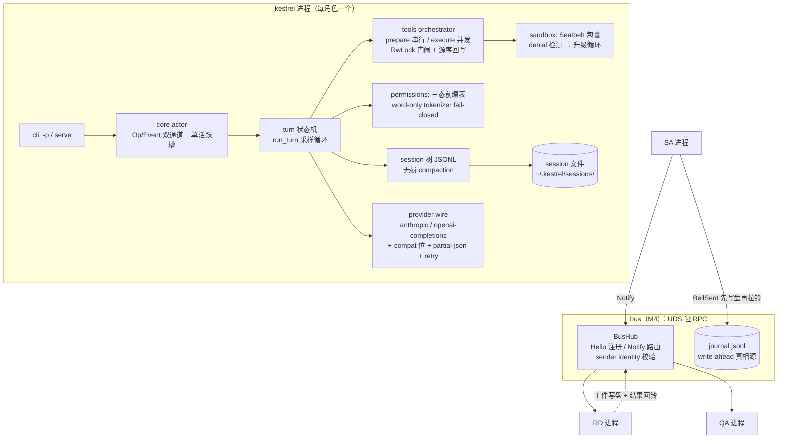

# kestrel 设计文档：Rust harness kernel

> 状态：M0-M4 已实现并通过测试（137/137，clippy `-D warnings` 干净）。
> 实现规模：src 47 文件 9,337 行 + tests 8 文件 1,872 行（plan 预算 ~10-13k 行内）。
> 输入：实现规划（plan.md）与调研语料（codex / pi study notes、三方资料库 references.md）——均为开发过程资料，未随本仓库发布。
> 本文沉淀实现后的最终设计；与 plan 的偏差在 §9 逐条记录。

## 1 定位与非目标

**定位**：为星型多 Agent harness（SA 协调者 + RD 写者 + QA 验证者，多进程各接异构 LLM 后端）提供的 Rust 引擎内核。无头/极简 CLI：`-p` 单发（默认模式）、`serve` 常驻 worker、`demo-sa` 脚本化 SA、`hub` 总线进程；worker 的后端/总线地址来自 role 文件（`[llm]`、`bus_socket`），CLI flag 可覆盖。

**非目标**（二期清单见 §10）：TUI、MCP、插件/扩展系统、OAuth 订阅登录、Linux 沙箱、openai-responses wire、tree-sitter-bash 命令解析、execpolicy DSL。

## 2 总体架构

核心循环为 codex 形 actor（Op/Event 双通道、单活跃槽、token 树取消）；会话与压缩为 pi 形（append-only 树 + first_kept 无损检查点）；权限接口为 pi 形（`tool_call` 前置策略）、执行兜底为 codex 形（Seatbelt 默认包裹 + denial 升级）。

## 3 三方血统映射

| 组件 | 血统 | 蓝本锚点 |
|---|---|---|
| Op/Event actor、取消三件套、length 整批 fail | Codex | study-core-loop §1-2/§5 |
| `prepare_next_turn` 轮间快照（压缩+换模型）、steering 队列 | pi | study-pi-agent §1 |
| Tool trait prepare/execute 拆分、`tool_call` block 钩子 | pi | study-pi-infra §2 |
| RwLock 并行门闸、FuturesOrdered 源序 | Codex | study-core-loop §3 |
| Seatbelt 模板 + rename 逃逸防护 + denial 升级 | Codex | study-permissions §3/§5 |
| 三态前缀表 + 危险前缀禁令 | Codex（execpolicy 简化版） | study-permissions §2 |
| session 树 + firstKeptEntryId 无损压缩 | pi | study-pi-agent §4 |
| provider 双轴注册表 + compat 位 + key 三态 | pi | study-pi-ai §1-3 |
| provider 项目层禁入、无隐式 env 继承 | Codex | study-provider-context §3 |
| 帧协议（长度前缀 + strict 信封 + opaque 载荷）+ 路由三元组 | pi protocol | study-pi-infra §4 |
| journal write-ahead、状态靠重放定义 | Codex rollout + harness v3 §5 | codex-study-notes §6.3 |

## 4 关键类型与五条不变式

关键签名见 plan §2（`WireFormat`/`Op`/`EventMsg`/`Tool`/`PermissionEngine`/`Sandbox`/`Entry`/`Envelope`/`JournalRecord`），实现位于 `src/provider/wire.rs`、`src/core/{ops,events,actor,turn}.rs`、`src/tools/{mod,orchestrator}.rs`、`src/permissions/mod.rs`、`src/sandbox/{mod,seatbelt}.rs`、`src/session/{entries,store}.rs`、`src/bus/{frame,rpc,identity}.rs`、`src/journal/{records,mod}.rs`。

实现强制的不变式（都有测试背书）：

1. **取消三件套**：每个 await 过 `or_cancel`；`tokio::spawn` 必须包 `AbortOnDropHandle`（`tests/discipline.rs` 静态闸门，fire-and-forget/managed 两类豁免标记）；`ResponseStream` drop 通知上游。
2. **fail-closed**：tokenizer 解析不了 → Ask；未设角色/无策略 → Ask 或 Deny；QA 写范围为零。
3. **只追加**：session 与 journal 永不截断；回滚/恢复 = 重放；半写容忍（残行 skip）。
4. **sender identity**：Hello 声明 + 帧内 sender 强一致；伪装者断连；bus 来源 item 渲染带 `<bell from>` 标注。
5. **journal 是真相**：StageWritten → BellSent → notify 的调用序强制 write-ahead；state 投影从 journal 重生成。

## 5 安全模型

双层：策略层（JSON 三态前缀表，policy = 数据，决策 Allow/Ask/Deny；`all_segments_explicitly_allowed` 才允许免沙箱）× OS 层（Seatbelt `(deny default)` + 参数化 writable_roots + 祖先 `file-write-unlink` 防 rename 逃逸 + 网络全禁仅留 loopback proxy）。沙箱失败经 exit 2/126/127/SIGSYS/stderr 特征判定 → ApprovalRequest → 批准后脱沙箱重试一次。**诚实边界**：v1 威胁模型是防手滑防漂移（同机同用户），命令解析是保守 word-only（`&&`/管道分段评估，其余结构一律判失败），不防恶意。

## 6 配置与多后端

| 层 | 来源 | 可定 provider/key |
|---|---|---|
| runtime | CLI flag | 是 |
| role | `harness/roles/<role>.toml` | 引用 + 权限/沙箱 |
| project | `.kestrel/kestrel.toml` | **否（启动即报错）** |
| user | `~/.kestrel/providers.toml` | 唯一归属地（key 三态：字面量 / `$ENV` / `!cmd`） |
| env | 仅被显式 `$VAR` 引用 | 无隐式 ANTHROPIC_* 回退 |

每角色一个 TOML = 「一角色一后端」：SA→qwen3.8-max、RD→deepseek-v4-flash、QA→glm-5.3-flash（示例见 `harness/roles/`）。对照 CC 方案（harness-v3 §6.2 的 settings 优先级对抗 + 钉全集仪式）此处 provider 归属在类型层唯一，无需仪式。

工具审批走同一条优先级链：`--approve all|none`（runtime）> role 的 `[permissions].approve` > `none`（拒绝，fail-closed）。此前 `serve` 硬编码 HeadlessDeny，worker 永远走不到「沙箱拒绝 → 审批 → 脱沙箱重试」这条回路；现在 role 可以自己声明（QA 保持默认拒绝 = 写范围为零的纪律不变，RD 也一样默认拒绝，只是不再是代码写死）。`ApproveMode::Bus`（把审批反向请求发给 SA/真人）仍是二期。

会话归属：`-p` 一次调用一个 append-only 树，默认新建，`--resume last|<id>|<path>` 续接；`serve` 一个 worker 一棵树 + 一个常驻引擎——每颗门铃是同一棵树上的下一个回合，因此历史、read-before-edit 台账与压缩检查点跨派发存活（`AgentHandle::spawn` 从树上重建 history/history_ids，并把 ctx_tokens 预置为重建上下文的估算值，否则恢复出的大会话要先采样一次才可能触发压缩）。

## 7 里程碑与验收（已全部达成）

| M | 内容 | 测试 |
|---|---|---|
| M0 | actor 循环 + SSE 归一化 + 取消 + steering + 最小 anthropic wire（2.4k 行） | 20 项：fixture 续轮/length 整批 fail/中断 100ms/steering 注入/spawn 闸门 |
| M1 | 4 工具 + 权限引擎 + Seatbelt + 三态表（1.8k 行） | 24 项：并发墙钟/沙箱 e2e×3（真实 sandbox-exec）/rename 逃逸/三态矩阵/edit golden/sbpl golden/错误回灌 |
| M2 | session 树 + 无损压缩（0.8k 行） | 15 项：golden JSONL/半写/fork/压缩触发+merge/开关模型落盘/resume |
| M3 | 诚实 wire 层：双 wire + compat + partial-json + thinking 回放 + retry + registry（1.5k 行） | 23 项：registry/金身回显/双 wire 归一/前缀穷举/重试矩阵/compat flip |
| M4 | 哑 RPC 总线 + journal + 三角色 demo（1.5k 行） | 13 项：帧 strict/路由/identity/注入面/崩溃对账/预算 |

**遗留人工项**：三端点 LLM 实测已全部完成（DeepSeek/BigModel 见 `smoke-report.md` §2.1-2.2，Qwen 见 §2.3；compat 偏差逐条落 compat 位，plan §7.1），其中 Qwen 暴露的 wire 层缺陷与修复见 §9.9。三角色联跑已跑通（`harness/run-demo.sh`，见 §9.11）。demo 任务下 RD/QA 曾在轮预算内收敛不到文字答复（工件 `stop` 显示 `round budget exhausted`）——那是任务/提示词层面的现象而非通路缺陷；自 §9.13 起 SA 只按工件内容判定（空结果=fail+回派），角色 prompt 也写了硬性收敛纪律，「pipeline complete」不再可能由空答案支撑。

## 8 测试策略

faux provider 第一天进 trait（`WireFormat` 抽象 ByteStream + `render_request` 纯函数）→ 零真 key 覆盖全部验收；三层测试（单元/组件 golden/e2e）；determinism 经 `IdGen`/`Clock` 注入；沙箱 e2e 仅 macOS（`#[cfg(target_os="macos")]`）；闸门 = `cargo fmt --check` + `clippy -D warnings` + 全测试。

## 9 与 plan 的偏差（诚实台账）

1. `Op::SwitchModel` v1 携带具体 spec（plan 为 provider id）——registry 落地后改为 id 解析已排入 M4 收尾，当前由调用侧解析。
2. `ensure_done` 适配器放 wire 层而非循环层（流尾恒一个 Done 的保证对双 wire 复用）。
3. compat 位收敛为 3 个有实际行为的 flag（`max_tokens_field`/`tolerate_unknown_finish`/`stream_include_usage`），plan 草案的 reasoning/thinking 格式位在 openai-chat wire 上以「不回发」策略落地（"Armin is wrong" 原则），未引入未用 flag。
4. partial_json 实现约 90 行核心（plan 估 250）：repair + 逐字符 pop 收敛足够覆盖测试矩阵。
5. demo-sa 是脚本化状态机（无 LLM 派发智能）——验证机械语义；智能派发为二期。
6. 里程碑行数落在预算下沿：引擎薄于预估（pi 佐证的 2k 结论），wire 层 1.5k 而非 4-5k——因为 v1 只钉两个 wire 且 compat 只实现有行为的位；三期端点实测可能上修。
7. **BigModel（glm-5.3-flash）实测三项偏差（2026-09-10 smoke）**：① CC 风格的 `[1m]` 模型后缀网关不认（报 1211 模型不存在），kestrel 用裸 id——该后缀是 CC 侧的上下文标记，若需 1M 上下文应映射为 beta header 而非模型名（二期 compat 位）；② 认证双头通吃：x-api-key 与 `Authorization: Bearer` 同时发送即通过（已实装，pi anthropic.ts 同法）；③ `message_start` 不回 input usage（`input_tokens=0`），usage 低报会推迟压缩触发——**已修**：ctx_tokens 记账改为「reported input 为 0 时用 TurnContext 字符估算兜底」（turn.rs + 回归测试 compaction_triggers_on_estimated_context）。
8. **DeepSeek（deepseek-v4-flash-vision-exp）实测（2026-09-10 smoke，双场景通过）**：对话流式与 bash 工具回合全通；usage 上报**完整**（input 565/output 21）——证实 input=0 低报为 BigModel 特有，§9.7③ 的估算兜底按端点自动分工正确；认证同走双头；cc-switch 配置中的 `[1m]` 后缀未测（用裸 id 通过）。
9. **Qwen（百炼 Token Plan）实测（2026-09-17 smoke）暴露 wire 层缺陷并已修**：openai 表面的流式 usage 恒为 0。根因不是端点低报（该端点上报完整），而是 `parse_stream` 一见 `finish_reason` 就终止，而百炼把 usage 放在其**之后**的 `choices: []` chunk——消费循环在 `Done` 处 break，尾部 usage 永远读不到。修法：终止推迟到 `[DONE]`/流尾，`finish_reason` 只记入 `pending_stop`；顺带把「有 `[DONE]` 无 `finish_reason`」判为 `Stop`（原判 `Aborted`，会让 turn 循环丢弃模型输出）。**影响面**：所有 usage 后置的 OpenAI 兼容网关——此前从未被真实端点跑过（DeepSeek/BigModel 走的是 anthropic wire）。回归测试 4 项；同轮修掉 thinking-only 回合的空 `message_done`。详见 `smoke-report.md` §6。
10. **Qwen 端点形态（2026-09-17 smoke）**：百炼 Token Plan 主机同时提供 anthropic 兼容（`/apps/anthropic`，供 SA 角色）与 openai 兼容（`/compatible-mode`，供 Codex）两个表面，两侧凭据实测**互通**；`/anthropic`、`/v1/messages`、`/compatible-mode/v1/messages` 均 404。openai 表面须置 compat 位 `stream_include_usage = true`，否则全程 `"usage": null`。provider 定义见 `~/.kestrel/providers.toml`（qwen-anthropic / bailian-qwen / deepseek-anthropic / zhipu-anthropic 四条，key 均以 `!cmd` 引用 cc-switch DB，不落明文）。
11. **三角色 demo 首次跑通（2026-09-17）**：`harness/run-demo.sh` 此前从未跑通，补齐四处：① 总线 hub 进程缺失——`BusHub::bind` 只在测试里被调用，新增 `hub` 子命令（脚本先起 hub 再起 worker，轮询 socket 就绪）；② CLI 形状不符——`serve`/`demo-sa` 改为子命令，`-p`/`--model` 改为可选（`-p` 单发保持向后兼容），`--rd-role`/`--rd-model` 这两个 demo 用不到的参数删除；③ role 的 `[llm]`/`bus_socket` 是死配置——`RoleConfig` 现在解析二者，worker 的后端与总线地址由角色声明（design §6 的"一角色一后端"首次真正落地）；④ 工件命名不一致——serve 写 `{session}-{route.session}-iter{n}.json`，SA 找的是 `{target}-{stage}-iter{n}.json`，"读盘为准"巡检永不命中，改为 `{session}-{stage}-iter{n}.json`。
    调试中另暴露两个真 bug：**role 相对路径基准错**（`harness/roles/rd.toml` 写 `prompt_file = "systems/rd.md"`，代码按 role 文件所在目录解析，实际文件在兄弟目录 `systems/`；`-p` 侧把这个错误静默吞掉回退成空 system prompt，所以只有 worker 起不来）与 **工具批次历史按调用交替提交**（见 §9.12）。工件新增 `stop` 字段，空结果从此可自解释。
12. **并行工具批次必须成组提交（2026-09-17）**：`outcomes_to_history` 原按「每个调用一对 assistant/user」交替写历史，导致第二个 `tool_use` 落在没有 thinking 块的 assistant 消息里。DeepSeek 在 thinking 模式下直接 400（`The content[].thinking in the thinking mode must be passed back to the API`），而同样的历史一次只有一个工具调用时不会触发——所以三端点 smoke 全绿也没暴露它。最小复现：交替形状 400 / Anthropic 惯用的「一个 assistant 装全部 tool_use、一个 user 装全部 tool_result」200。修法：改为 `outcomes_to_history` 批量提交（全部 tool_use 在前、全部 tool_result 在后），openai wire 相应把同批 `tool_calls` 合并进一条 assistant 消息。

13. **一期标称但没接线的四处（2026-10-26 冒烟复盘，已修）**：
    ① `serve` 在每颗门铃里 `AgentHandle::spawn` 且传 `session: None`——worker 跨铃无历史、`~/.kestrel/sessions` 里连一个 worker 会话文件都没有，「常驻」名不副实。改为一个 worker 一个常驻引擎 + 一棵会话树（回归测试 `resumed_store_carries_history_into_the_next_turn`）。
    ② 会话树与无损压缩在 CLI 上**不可达**：`SessionStore::open/prompt_items` 只被测试调用，`-p` 没有续接口，而 `should_compact` 只在回合起点检查（`-p` 恰好只有一个回合）。新增 `--resume last|<id>|<path>`（配套 `SessionStore::list/resolve`），spawn 时从树上重建 history/history_ids 与 read-before-edit 台账，并把 `ctx_tokens` 预置为重建上下文的估算值——否则恢复出的大会话要先生成一轮才可能触发压缩（回归 `resume_compacts_before_the_first_sample`）。
    ③ `--tools` 是 `default_value_t = true` 的 bool flag：只能开不能关，`--tools false` 报「unrecognized subcommand」，而 README/help 把它写成 opt-in。改为默认关 + `--tools[=BOOL]`（`num_args = 0..=1` + `default_missing_value`）。
    ④ `serve` 硬编码 `ApproveMode::HeadlessDeny`，worker 走不到「沙箱拒绝 → 审批 → 脱沙箱重试」这条回路。新增 role 键 `[permissions].approve`（非法值一律回落为拒绝）+ `--approve` 覆盖，优先级 runtime > role > 拒绝。
14. **demo 的 pass 是假的（2026-10-26 冒烟复盘，已修）**：`sa_demo` 判 stage 收敛只看工件是否存在，不读 `result`/`stop`，于是 RD 那份 `result:""` + `stop:"round budget exhausted"` 的工件也能让四个 stage 全绿并打出「pipeline complete」。现在判定只读盘（`verdict_from_artifact`：空结果、aborted、`stop.type == "error"` 均为 fail），fail 走真实回派环——iter 自增、journal 落 `pass:false` 的 `result_committed`。demo 预算 2.0 只够 4 次派发（一次回派即触顶），默认上调为 4.0 并开放 `--max-usd`。两个角色 prompt 同时补了硬性收敛纪律（最后一次回合必须留给人工可读的文字结论；同类工具失败最多再试一次），否则「修好判定」只会把联跑变成常红。
15. **闸门与诊断（2026-10-26 冒烟复盘，已修）**：rust/clippy 1.98 新增 `clippy::question_mark` 让 `cargo clippy --all-targets -- -D warnings` 破功（tokenizer 的悬空转义分支）；配置类错误只吐 `No such file or directory (os error 2)` 而不说是哪个文件——role config 读/解析、policy 表、system prompt、provider registry 四处全部带上路径。design/README 的规模数字按实测修正。
16. **「读盘为准」缺了指针本身（2026-10-26 修判定后暴露）**：`serve` 只把铃 payload 的 `task` 塞进 prompt，`check` 与 `ref`（artifacts/worktree 路径）被丢掉，worker 拿不到验证对象——QA 连续三轮只能回「证据不足（缺 ref.worktree）」。修法：`bell_prompt()` 把 task/check/iteration/ref 一并交给 worker（铃仍是薄消息，但指针必须可读），demo-sa 的 `ref` 补 `--worktree` 广播 RD 的写入目录。修完判定才真正有意义：worker 自述 `PASS`/`DONE` 为收敛，`FAIL`/`BLOCKED`/无判定词为 fail 并回派（`verdict_marker_decides_the_stage`）。
17. **联跑的计时与预算假设过期（2026-10-26）**：SA 原先硬编码 180s 等回铃、2.0 USD 预算，二者都是「一次派发 = 一次冷引擎」时代的数字。常驻引擎 + 8 轮工具回合 + 真网关（BigModel 单轮实测 48-77s）下 180s 必然误判为「铃丢了」；一次诚实回派也会直接触顶。改为 `--bell-timeout-secs`（默认 300）与 `--max-usd`（默认 6.0 = 4 stage × 3 iter × 0.5，让预算覆盖声明的重试策略），run-demo.sh 可用 `KESTREL_DEMO_BELL_TIMEOUT` / `KESTREL_DEMO_MAX_USD` 覆盖。
18. **判定变严之后，demo 自身的矛盾才暴露（2026-10-26）**：① 角色 prompt 要求 RD/QA「把结果写进 artifacts」，可 RD 的写范围只有 worktree、QA 写范围为零——它们每轮都在撞自己角色的墙；结论改为「文字回答，由 `serve` 落成工件」。② QA 没有目录发现手段（策略只放 `ls`/`rg`/`cat`/`cargo`/`python3 -m`），又没有 RD 产出清单，只能猜文件名，三轮都只能回「证据不足」；因此 RD 的 `DONE` 必须逐条列出新建/修改的绝对路径与测试入口，QA 按清单取证（读 RD 工件 → 按路径读源码 → 单条已允许的命令执行），并且 `python3 -m` 进入两侧允许表（此前 QA 的允许表里没有测试运行器，`test` stage 在结构上不可能拿到执行证据）。③ 命令拼接纪律：`&&`/管道分段求值，任一段不在允许表里整条被拒——prompt 里写明用单条命令，避免把策略失败读成实现失败。这三条都不是内核缺陷，但只有先把 SA 判定做实，它们才会被看见（此前「工件存在即 pass」把它们全盖住了）。

## 10 二期清单

tree-sitter-bash 命令解析、execpolicy DSL（Starlark）、landlock/bwrap（Linux）、TUI（行级 diff 形制，pi-tui 蓝本）、openai-responses wire、MCP 客户端、model-in-the-loop evals、journal 快照/截断语义、bus 重连重放、多任务并行（peers 加 task 前缀）。

另加两条本次复盘划出的边界：`ApproveMode::Bus`（worker 把审批反向请求发给 SA/真人，而不是靠 role 预先声明 none/all 二值）；SA 判定从「工件文字」升级到「工件 + 证据文件」（截图/测试产物路径核对），当前 `verdict_from_artifact` 只做到不放过空答案。
